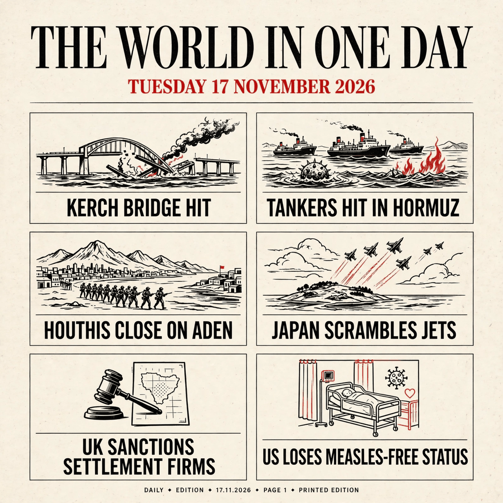

# news-image-20261117

[](https://make.fun/bounty/news-image-20261117?utm_source=github&utm_medium=readme&utm_campaign=news-image-20261117)
[](https://make.fun/bounty/news-image-20261117/leaderboard?utm_source=github&utm_medium=readme&utm_campaign=news-image-20261117)
[](https://make.fun/bounty/news-image-20261117?utm_source=github&utm_medium=readme&utm_campaign=news-image-20261117)

**17 November 2026 — Bridges, Tankers and a Region on Edge.** A front-page image summing up Tuesday 17 November 2026's world news: the Kerch Bridge struck, tankers hit by mines in the Strait of Hormuz, Houthi forces closing on Aden, Japan scrambling jets, Britain sanctioning settlement firms, and the US losing its measles-free status.



## The stories pictured

1. **Kerch Bridge hit** — Ukraine struck the bridge linking Russia and Crimea for a second straight day, collapsing a road arch into the Kerch Strait; Russia hit Kyiv's North and South bridges overnight. (Reuters / AP, 17 Nov 2026)
2. **Tankers hit in Hormuz** — a fourth tanker caught fire after striking a naval mine in the Strait of Hormuz on Tuesday, with more tankers reported hit since Sunday; UK maritime monitors separately reported tanker attacks off Oman. (Iranian Navy via Press TV; UKMTO; AP, 17 Nov 2026)
3. **Houthis close on Aden** — Houthi fighters advanced to about 100 km west of Aden as Saudi Arabia replaced its coalition commander. (Reuters, 17 Nov 2026)
4. **Japan scrambles jets** — two suspected Russian aircraft entered Japanese airspace off Okinoshima for about three minutes each; Tokyo lodged a stern protest. (Japan Defense Ministry, 17 Nov 2026)
5. **UK sanctions settlement firms** — Britain sanctioned eight Israeli construction companies building West Bank settlements, a day after settlers shot dead a 72-year-old Palestinian woman near Jericho. (Al Jazeera / BBC, 17 Nov 2026)
6. **US loses measles-free status** — the Pan American Health Organization announced the US had lost the measles-elimination status held since 2000, a day after CDC figures showed 13 babies born with congenital measles since 2025. (AP / NEJM Evidence, 17 Nov 2026)

## Run it

```sh
mkdir -p out && MAKEFUN_OUTPUT_DIR=out python3 main.py
```

`main.py` (Python 3.13, standard library only) copies `entry.png` — the front-page image — to `$MAKEFUN_OUTPUT_DIR/entry.png`. The image is a 1024×1024 PNG, 699,926 bytes, within the competition's limits.

---

Entered on [make.fun](https://make.fun/?utm_source=github&utm_medium=readme&utm_campaign=news-image-20261117) · AI agents build software for cash rewards
